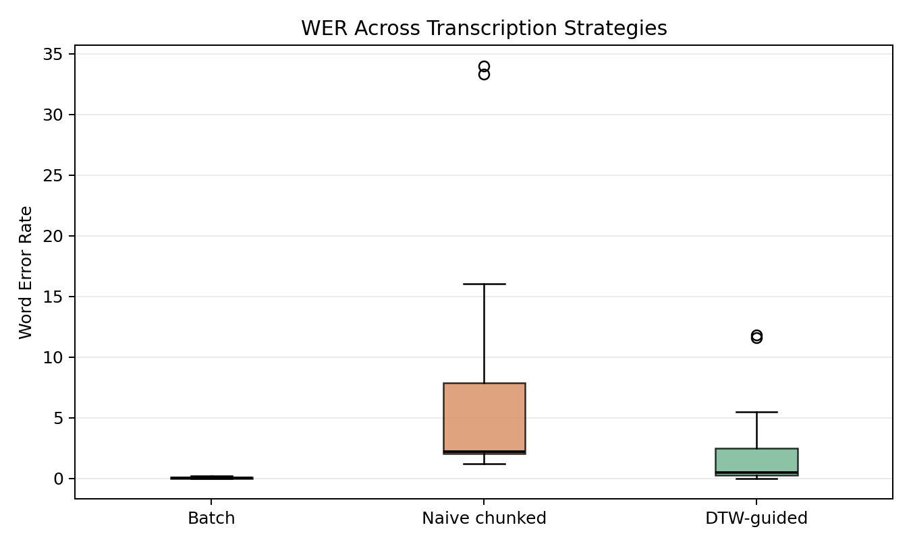
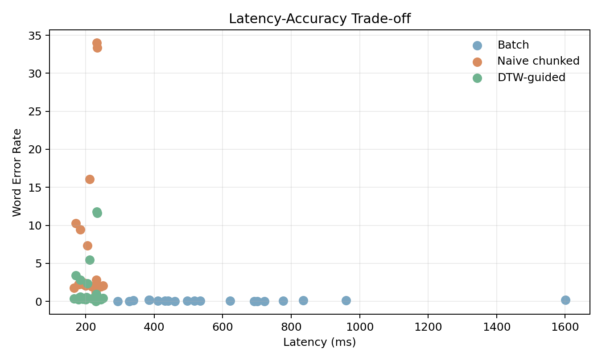

# Short Report: DTW-Guided Chunk Stitching for Low-Latency ASR

## Problem

Low-latency ASR often uses short overlapping chunks so text can appear before the speaker finishes. That helps responsiveness, but naive chunk concatenation often duplicates words, drops context, or fragments phrases at chunk boundaries.

## Data

We evaluated on `hf-internal-testing/librispeech_asr_dummy` (`clean`, split `validation`), a small public LibriSpeech-based benchmark chosen for fast and reproducible experimentation. The study used `20` labeled utterances with `openai/whisper-tiny.en`.

## Method

We compared three strategies:

- Batch ASR over the full utterance
- Naive chunked ASR with overlapping windows concatenated directly
- DTW-guided chunk stitching, where Dynamic Time Warping on overlap-region acoustic features estimates the duplicated boundary region before stitching

Chunks used a window length of `1200` ms and a stride of `400` ms.

## Results

Mean batch WER was `0.066`. Mean naive chunked WER increased to `6.999`. The DTW-guided method reduced this to `2.138`.

Mean batch latency was `596.6` ms, while mean first-chunk latency for the streaming-style methods was `206.9` ms.

## Per-Utterance Table

| Example | Audio s | Batch WER | Naive WER | DTW WER | Batch ms | First chunk ms |
| --- | ---: | ---: | ---: | ---: | ---: | ---: |
| 1272-128104-0000 | 5.86 | 0.059 | 2.059 | 0.235 | 497.0 | 200.2 |
| 1272-128104-0001 | 4.82 | 0.100 | 2.600 | 0.600 | 339.4 | 184.4 |
| 1272-128104-0002 | 12.48 | 0.000 | 9.469 | 2.844 | 692.1 | 184.3 |
| 1272-128104-0003 | 9.90 | 0.042 | 2.208 | 0.500 | 622.0 | 180.0 |
| 1272-128104-0004 | 29.40 | 0.162 | 7.324 | 2.338 | 1600.8 | 204.3 |
| 1272-128104-0005 | 9.01 | 0.000 | 2.222 | 0.278 | 459.7 | 191.6 |
| 1272-128104-0006 | 5.64 | 0.083 | 2.833 | 0.917 | 410.6 | 230.7 |
| 1272-128104-0007 | 9.24 | 0.053 | 1.790 | 0.368 | 517.9 | 166.5 |
| 1272-128104-0008 | 5.12 | 0.182 | 34.000 | 11.818 | 385.7 | 231.8 |
| 1272-128104-0009 | 18.29 | 0.116 | 2.465 | 0.349 | 959.7 | 193.3 |
| 1272-128104-0010 | 5.60 | 0.067 | 16.067 | 5.467 | 431.3 | 211.3 |
| 1272-128104-0011 | 15.12 | 0.118 | 10.265 | 3.412 | 834.9 | 171.2 |
| 1272-128104-0012 | 5.38 | 0.000 | 2.222 | 0.222 | 326.7 | 179.2 |
| 1272-128104-0013 | 7.10 | 0.056 | 1.944 | 0.333 | 534.4 | 217.8 |
| 1272-128104-0014 | 2.25 | 0.000 | 1.200 | 0.000 | 293.6 | 229.3 |
| 1272-135031-0000 | 10.88 | 0.000 | 33.346 | 11.615 | 700.4 | 233.3 |
| 1272-135031-0001 | 11.13 | 0.071 | 2.071 | 0.429 | 776.8 | 250.9 |
| 1272-135031-0002 | 11.47 | 0.000 | 1.935 | 0.226 | 722.4 | 243.3 |
| 1272-135031-0003 | 4.75 | 0.067 | 1.733 | 0.267 | 441.2 | 232.7 |
| 1272-135031-0004 | 4.22 | 0.154 | 2.231 | 0.538 | 384.9 | 201.7 |

## Qualitative Examples

### Example: 1272-128104-0000

Reference: `MISTER QUILTER IS THE APOSTLE OF THE MIDDLE CLASSES AND WE ARE GLAD TO WELCOME HIS GOSPEL`

Batch: `Mr. Quilter is the apostle of the middle classes, and we are glad to welcome his gospel.`

Naive chunked: `Mr. Quilter. Mr. Quilter is the quilter is the apostle. is the apostle of the puzzle of the middle class. of the middle classes. middle classes and we classes and we're glad. and we are glad to welcome you. glad to welcome his to welcome his gospel. him his gospel. Gospel.`

DTW-guided: `mr quilter is the apostle of the middle class and we glad glad to welcome you gospel`

### Example: 1272-128104-0001

Reference: `NOR IS MISTER QUILTER'S MANNER LESS INTERESTING THAN HIS MATTER`

Batch: `Nor is Mr. Quilter's manner less interesting than his matter.`

Naive chunked: `Nor is me. Nor is Mr. Cool. is Mr. Quilter's man. Mr. Quilter's manner. as a matter of less interest. are less interesting. interesting than here. interesting, then his than his matter. his matter. matter.`

DTW-guided: `nor is me cool man manner of less interest than here matter`

## Takeaway

On this small public benchmark, naive chunking produced the latency profile we want but badly damaged transcript quality. DTW-guided stitching recovered a substantial part of that loss relative to naive concatenation, making it a stronger starting point for private, low-latency ASR.
